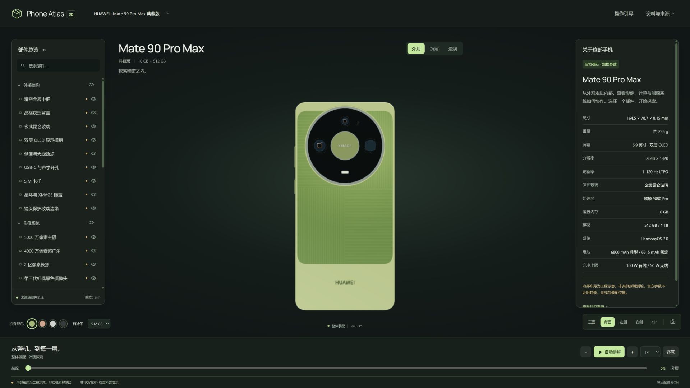

# Phone Atlas 3D

[在线浏览](https://lyl-z.github.io/phone-atlas-3d/) · [公开源码与审查](https://github.com/LYL-Z/phone-atlas-3d) · [自动检查与部署](https://github.com/LYL-Z/phone-atlas-3d/actions)



本地交互手机拆解网站，首期 HUAWEI Mate 90 Pro Max 典藏版。运行时代码仅 HTML、CSS、原生 JavaScript ES Modules 与 Three.js 0.180.0 官方 addons，所有三维几何由代码构造。无需外部模型、API Key、CDN、图片或网络请求。第三方参考图不作为运行资产。

## 启动

需要 Node.js 20 或更新版本。在 PowerShell 中运行：

```powershell
cd D:\phone
npm start
```

打开 <http://127.0.0.1:4173/>。交付已附 `vendor/`，启动不需要 `npm install`。不要用 `file://` 打开。端口被占用时使用 `$env:PORT=4174; npm start`，或访问已经运行的 4173 服务。

本次开发服务仅监听 127.0.0.1。可运行 `Start-Phone-Atlas.cmd`。停止服务用所在终端的 Ctrl+C。源码已按用户要求准备为公开 GitHub 仓库；不分发原始参考图。

## 使用

- 拖动模型旋转，滚轮缩放；触控支持由官方 OrbitControls 提供的单指旋转、双指缩放/平移。真机触控尚未验收。
- 点击部件或部件树同步资料和高亮；内部件自动展开到可查看进度。双击或“对焦部件”移动相机。Escape 退出选择与小屏抽屉。
- 进度滑块直接控制拆解；支持自动播放/暂停、前进/后退、反向装配、0.5×/1×/2×、还原。状态来自同一基准变换，不累加位移。
- “透视”将外壳半透明化；关闭后恢复材质。眼睛按钮控制单件/分组可见性。还原会恢复显示状态。
- 左树支持搜索、分组折叠，方向键/Home/End 移动部件焦点，Enter 选择。
- 四色、512 GB / 1 TB SKU、正/背/左/右/45°视角、三步引导、来源弹窗。
- 相机按钮导出透明背景的三维场景 PNG（不含网页 UI）；“导出配置 JSON”保存当前状态、部件 ID 和拆解向量，当前版本不支持导入。
- 顶部第二机型“ATLAS LAB · 通用设备”是明确标注的虚构测试设备，仅用于证明通用引擎复用。

## 工程结构

| 位置 | 职责 |
|---|---|
| `src/core/` | 场景、相机、状态、可逆动画、选取、注册表、材质、部件合批 |
| `src/factories/` | 中框与外装、镜头、PCB 和其他部件的程序化几何 |
| `src/devices/` | DeviceDefinition、物理参数、事实、部件树、装配坐标、爆炸顺序 |
| `src/ui/` | 控制、部件树、资料卡、遮挡处理与引线标签 |
| `src/data/sources.js` | 来源账本及 `sourceUrl/sourceType/confidence/verifiedAt` |
| `vendor/` | 固定版本 Three.js 及官方 addons；许可证一起保留 |
| `tests/` | Node 数据/动画测试与浏览器验收台 |
| `evidence/` | 当前测试 JSON、截图、参考图清单及检查日志 |
| `checkpoints/M0`—`M4` | 分阶段可运行快照；进入相应目录运行 `node scripts/serve.mjs` |

统一单位：1 Three.js unit = 10 mm，X 宽度，Y 长度，+Z 屏幕朝向。164.5 × 78.7 × 8.15 mm 为机身包络，镜头凸起不作为官方厚度测量数据。各部件中心和局部厚度按图近似或示意。`assembledTransform` 是唯一装配基准；`explodeOrder` 控制延迟，`explodeVector` 控制最终位移。

## 增加机型

新建一个 DeviceDefinition，填入品牌、版本、SKU、尺寸、配色、事实、分类与部件数组。在 `app.js` 的启动注册区调用 `registerDevice(definition)` 即可出现在菜单中。渲染器、树、选取和动画无需复制。复杂新形状在工厂表中注册新工厂。`genericTestDevice.js` 演示了这一点。折叠机只预留 `capabilities.hinge` 接口，未实现真实铰链或虚构折叠产品。

## 验证和复现

```powershell
npm test
```

浏览器验收：启动服务后打开 <http://127.0.0.1:4173/tests/browser.html>，点击“运行 10 轮验收”，完成后下载 JSON。该验收调用真实页面控件并读取渲染模型，属于浏览器内模拟交互测试；它不能替代物理手机、人工逐帧碰撞检查和低配设备测试。

逐项结果见 [TEST_CHECKLIST.md](TEST_CHECKLIST.md)，来源与图像冲突见 [SOURCE_NOTES.md](SOURCE_NOTES.md)。本机截图以 `evidence/desktop-*` 和 `evidence/mobile-*` 为准。

## 真实性和当前限制

本项目非华为官方，不暗示官方认证。外观是基于图片与官方总尺寸的程序化近似，不能称为实物测绘级复刻；微小倒角、宝石光学、背盖纤维、精确孔径和镜头凸起仍有偏差。内部 PCB、封装、RAM 与存储布局、电池尺寸、VC、线圈匝数、FPC、螺丝和支撑件均为工程示意。官方确认功能与参数，不证明示意几何和装配位置。

Z10 只保留资料入口，未实现可选外接配件装卸。不存在芯片裸片透视或已核实晶粒重建。无外部模型；未获得/发布第三方照片的再分发授权。完整源码压缩包排除用户参考图。

桌面 Chrome/Edge 为优先环境，要求 WebGL 2。WebGL 创建失败和模块加载失败会给出提示，图形上下文丢失提示刷新；该降级路径有代码，是否实际触发以验收表为准。主流桌面、手机性能不能由本机高配 GPU 的帧率推定。
